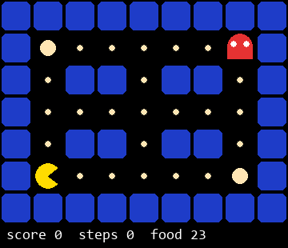
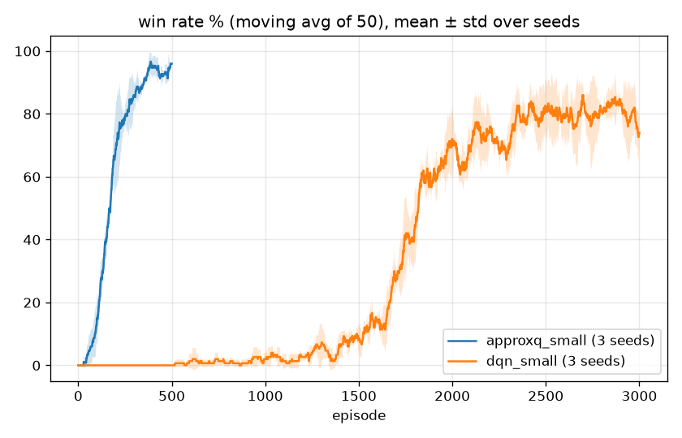
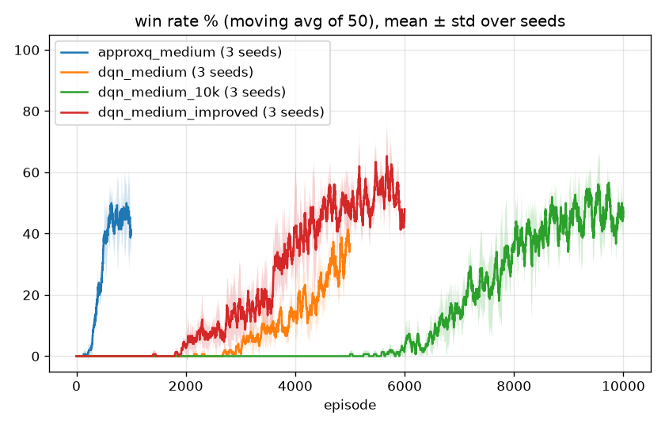
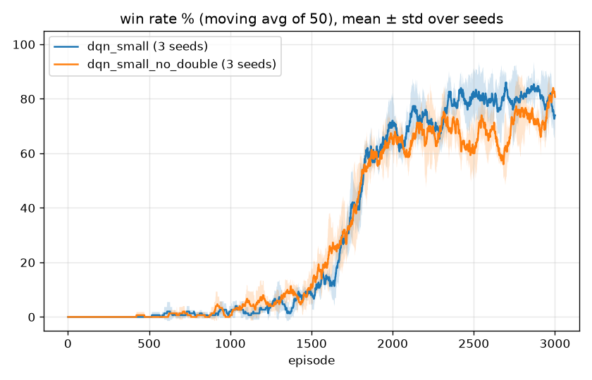

# Mini Pac-Man with Reinforcement Learning

A small Pac-Man game where an agent learns to win on its own, using two methods:

1. **Approximate Q-learning**: a linear model over features I designed by hand
2. **DQN (Deep Q-Network)**: a CNN that learns straight from the grid

| DQN, medium maze | approximate Q-learning, small maze |
|---|---|
|  |  |

## The game

- Pac-Man wins by eating all the food (`.`)
- A ghost touching Pac-Man means game over
- Eating a capsule (`o`) scares the ghosts for 20 steps, and Pac-Man can eat them
- Ghosts mostly move randomly but sometimes chase (`--ghost-chase`, default 0.2)
- Mazes: `tiny`, `small` (1 ghost), `medium` (2 ghosts), and `unseen` (2 ghosts, only
  used to test generalization), see `pacman/layouts.py`
- A game ends after 300 steps at most

| event          | reward |
|----------------|--------|
| each step      | -1     |
| food           | +10    |
| capsule        | +20    |
| eat scared ghost | +200 |
| win            | +500   |
| caught         | -500   |

## Project structure

```
pacman/              the game
  layouts.py         maze maps, parser and maze distances (BFS)
  env.py             game rules (reset / step, like a gym env)
  ghosts.py          how the ghosts move
  observation.py     the grids the DQN sees
  render.py          terminal and pygame drawing
  live_view.py       live chart + game window while training
agents/              the learning code
  features.py        features for approximate Q-learning
  approx_q.py        approximate Q-learning agent
  dqn.py             DQN agent (CNN, target net, double DQN)
  replay_buffer.py   the replay buffer for DQN
  baselines.py       random and food-only agents to compare against
  planner.py         lookahead planner that knows the rules (no learning)
  training.py        one training episode, and the test without random moves
  loading.py         creating / loading agents
tests/               unit tests for the game rules, features and agents
train.py             train one agent, save the model and a csv log
play.py              watch a trained agent play
ghost_test.py        check whether the agents really avoid ghosts
planner_test.py      how well the lookahead planner plays
generalization_test.py  approximate Q-learning weights on other mazes
make_gif.py          record a trained agent as a gif
run_experiments.py   run every experiment with 3 seeds
summarize.py         results table and charts for the experiments
plot_results.py      learning curves for single runs
models/              trained models (dqn_medium.pt is the best medium maze run, seed 0)
results/             training logs and charts
```

A full explanation of the theory, every file and function, the experiments and
likely questions is in [EXPLANATION.md](EXPLANATION.md).

## How to run

```
pip install -r requirements.txt
# (for the smaller CPU-only torch, install it first with
#  pip install torch==2.15.0 --index-url https://download.pytorch.org/whl/cpu)

python train.py --agent approxq --episodes 500
python train.py --agent dqn --episodes 3000
python train.py --agent dqn --live          # watch it learn

python play.py --agent approxq
python play.py --agent dqn --text

python play.py --agent dqn --layout medium

python ghost_test.py --games 200
python planner_test.py --layout medium --depth 3
python generalization_test.py
python make_gif.py --agent dqn --layout medium
python -m unittest -v
```

To repeat all the experiments below (this takes several hours, mostly the DQN runs):

```
python run_experiments.py
python summarize.py
```

## How the algorithms work

**Approximate Q-learning.** Instead of a table with one entry per state,
Q(s,a) = Σ wᵢ·fᵢ(s,a). The features are things like "how many ghosts are one step
away", "distance to the closest food" and "does this move eat food". After every step:

```
diff = (r + γ · max_a' Q(s',a')) − Q(s,a)
wᵢ  ← wᵢ + α · diff · fᵢ(s,a)
```

It learns very fast (a few hundred games), and you can read the weights to see what
it learned, for example a big negative weight on `ghosts-1-step-away`.

**DQN.** The board is turned into 6 grids (walls, food, capsules, pacman, ghosts,
scared ghosts) and passed through a CNN that outputs one Q-value per action.
With `--ghost-directions` there is a 7th grid showing where each ghost just came from.
Some tricks keep training stable:
- a replay buffer, so it trains on random past transitions
- a target network that is updated every 1000 steps
- double DQN to reduce over-estimation
- rewards scaled by 0.01, Huber loss, gradient clipping
- epsilon-greedy exploration going from 1.0 down to 0.05

DQN needs far more games than approximate Q-learning, but it doesn't need any
hand made features.

## Results

Every experiment was trained 3 times with different seeds (0, 1, 2). The numbers are
mean ± standard deviation over the 3 runs. "Test" means 100 games without random
moves after training. "Episodes to 80% wins" is when the win rate over the last 50
training games first reaches 80%.

| experiment | test win rate | test avg score | episodes to 80% wins |
|---|---|---|---|
| approxq, small maze | 96% ± 1 | 883 ± 13 | 228 ± 27 |
| dqn, small maze | **100% ± 1** | **1073 ± 12** | 2138 ± 161 |
| approxq, medium maze | 63% ± 3 | 794 ± 56 | never |
| dqn, medium maze, 5000 episodes | 73% ± 5 | 1043 ± 36 | never (training reached ~40%) |
| dqn, medium maze, 10000 episodes | 79% ± 4 | 1170 ± 86 | never (training reached ~50%) |
| dqn, medium maze, improved, 6000 episodes | **82% ± 6** | **1237 ± 68** | never (training reached ~55%) |
| dqn, medium maze, improved + best model + epsilon 0.01 | 78% ± 4 | 1173 ± 80 | 3152 ± 188 |




- Both methods solve the small maze with every seed, so the result is not luck.
- Approximate Q-learning learns about **10 times faster** (around 230 episodes, under
  a minute) but DQN ends up a bit better, mostly because it eats more scared ghosts.
- On the medium maze (2 ghosts, about 4 times the food) approximate Q-learning only
  wins 63%. Probably because its features only look at the closest ghost and the
  closest food, which is not enough to plan around two ghosts in a bigger maze.
- DQN does better on the medium maze but needs a lot more time. With 5000 episodes
  it wins 73%, and it wins almost nothing until the random moves drop low (around
  episode 2,700). Each run took about 8 hours.
- Its curve was still going up at episode 5000, so I trained it again with 10000
  episodes (about 11.5 hours per run). That got it to **79% wins** and a higher score.
  The training curve flattens out around 45-50% after episode 8,500, so doubling
  the episodes again would probably give only a small gain.
- Almost every game the 10000 episode agent lost was a ghost catching it late in the
  game (about 12 of the 50 food left), not running out of time. So the **improved**
  run changes two things: the random moves fade out over the first 2000 episodes
  instead of 60% of the training (`--eps-episodes 2000`), and the network gets a 7th
  grid with the cell each ghost just came from (`--ghost-directions`). Ghosts never
  turn back, so this shows which way they are going.
- The improved agent starts winning around episode 2,000 instead of 6,000 and gets
  **82% wins with 6000 episodes**, slightly better than 79% with 10000. The gain is
  within the spread between seeds (75%, 84% and 87%), so the clear win is that it
  gets there with 40% fewer episodes. Both changes were made together, so this
  doesn't say which one helped more.
- The test win rate is higher than the training curve because the test has no
  random moves.
- The last run tried two more things on top of the improved one: epsilon goes down to
  0.01 instead of 0.05 (`--eps-end 0.01`), and every 250 episodes the agent plays 50
  test games and only the best version is kept (`--eval-every 250`). **It didn't
  help** (78% vs 82%, inside the spread between seeds):
  - The training curve went up to 70-85%, but only because there are fewer random
    moves in training. The agent itself plays about as well as before.
  - The best checks were 88-90%, but the final 100 game tests of the same models were
    74-81%. With 50 games, picking the highest check also picks the luckiest one.
  - A 100 game test is itself only accurate to about ±4%, so all the DQN versions
    from 79% to 82% are basically the same. Telling them apart would need more
    seeds and more test games.

### How good can it get? A planner to compare with

*The planner is not a reinforcement learning algorithm and not part of the project's
methods. It is a baseline, like the random and food-only agents, only a much stronger
one.*

Every DQN version stopped at about 80% on the medium maze, and every lost game was a
ghost catching pacman. To see if 80% is close to the best possible, `agents/planner.py`
plays with a lookahead (expectimax) instead of learning. It knows the real game rules
and how the ghosts move, tries every move a few steps ahead and averages over where
the ghosts could go. It is not a fair opponent for the learned agents, because they
have to find all of this out by playing, but it shows how well the game can be played.

| agent (medium maze) | test win rate | avg score |
|---|---|---|
| approxq | 63% | 794 |
| dqn (best version) | 82% | 1237 |
| planner, 1 move ahead | 75% | 869 |
| planner, 2 moves ahead | 87% | 1179 |
| planner, 3 moves ahead | 89% | 1258 |
| planner, 4 moves ahead | 91% | 1377 |
| planner, 5 moves ahead | 95% | 1502 |
| planner, 6 moves ahead | 95% | 1561 |

(planner: 500 games each, `python planner_test.py --layout medium --depth 3`)

- **There is room left above DQN.** Looking 5 moves ahead wins 95%, so 80% is not
  the limit of the game. Looking 6 moves ahead adds almost nothing (95.4% vs
  94.8%), so about 95% seems close to the best possible: roughly 5% of the games
  look truly lost.
- DQN plays about as well as a planner that looks **1 to 2 moves ahead**. It reacts
  well to a ghost that is close, but doesn't plan far enough to avoid getting
  trapped between two ghosts later.
- On the small maze the planner wins 99% with 3 moves, about the same as DQN (100%).
  The small maze is basically solved by both.

### Does it work on a maze it never saw?

The features of approximate Q-learning don't depend on the maze (distances, "ghost one
step away", ...), so the learned weights can be used on any maze. `generalization_test.py`
takes the weights trained on the small and on the medium maze and plays 500 games on
every maze, including `unseen`, a new 11×9 maze with 2 ghosts that was never used
for training.

| weights trained on | tiny | small | medium | unseen |
|---|---|---|---|---|
| small maze | 100% | 96% | 63% | 74% |
| medium maze | 100% | 97% | 59% | 70% |
| *trained on that maze itself* | | *96%* | *63%* | *71% ± 4 (3 seeds)* |

- **The weights transfer with no loss.** The weights from the small maze (1 ghost)
  win just as much on the medium maze as weights trained on the medium maze itself
  (63%), and on the unseen maze they do as well as training on it directly.
- This makes sense: the features describe the situation around Pac-Man, not the
  maze, so "don't step next to a ghost, go for food" works everywhere. What limits
  it on the bigger mazes is the features (they only look one step ahead), not the
  training maze.
- DQN can't do this. Its network takes the whole grid as input, so a model only
  fits mazes of the size it was trained on, and it learned that one maze.

### Are our ghosts harder than the usual ones?

Other approximate Q-learning projects (on the Berkeley Pac-Man game) report around 90%
wins on their medium maze, more than our 63%. Their ghosts move completely at random
by default, while ours chase pacman 20% of the time. To check how much this matters,
the same training was run with `--ghost-chase 0` (ghosts still never turn back, like
the Berkeley ones):

| experiment (medium maze, 1000 episodes) | test win rate | test avg score |
|---|---|---|
| approxq, ghosts chase 20% of the time | 63% ± 3 | 794 ± 56 |
| approxq, random ghosts | **74% ± 5** | **1003 ± 65** |


- The chasing ghosts cost about **11% of the wins**. With random ghosts every seed wins
  more (76%, 69%, 78%) and the training curve is higher the whole time.
- It still doesn't reach 90%, so the ghosts are only part of the difference. The rest
  comes from the maze itself (ours is not the same maze) and from the features only
  looking one step ahead. The 90% number is also one student project tested on 40
  games, so it is not an exact target.

### Ablations

What happens when parts of the method are taken away (small maze, 3 seeds each):

| experiment | test win rate | test avg score | episodes to 80% wins |
|---|---|---|---|
| approxq (all features) | 96% ± 1 | 883 ± 13 | 228 ± 27 |
| approxq without ghost features | **43% ± 1** | **215 ± 39** | never |
| approxq without scared-ghost features | 97% ± 3 | 876 ± 16 | 213 ± 27 |
| dqn (double DQN) | 100% ± 1 | 1073 ± 12 | 2138 ± 161 |
| dqn without double DQN | 98% ± 2 | 1083 ± 12 | 2423 ± 380 |




- **The ghost features are what makes approximate Q-learning work.** Without
  `ghosts-1-step-away` and `ghost-closeness` the agent can't see danger, and the win
  rate stays around 30% during training (43% in the test).
- The scared-ghost features (`eats-scared-ghost`, `scared-ghost-closeness`) don't change
  the result. On this small maze the scared ghost is usually close anyway, so hunting
  it on purpose doesn't add much.
- **Double DQN helps a little.** It reaches 80% wins about 300 episodes earlier and
  its training win rate stays around 80% instead of 65-75%, but the final test results
  are almost the same. With only 3 seeds and overlapping error bars, this difference
  is small and not conclusive.

### Do they really avoid the ghosts?

`ghost_test.py` plays 200 games per agent and compares them with two baselines:
**random** (any legal move) and **food-only** (always walks to the closest food and
ignores the ghosts). A *close call* is an active ghost coming within 2 steps of
pacman; it counts as *escaped* if pacman is still alive 3 steps later.
The agents were trained with ghosts chasing 20% of the time, and tested against
more aggressive ghosts as well.

| ghosts chase | agent | win | caught | close calls / game | escaped | ghosts eaten / game |
|---|---|---|---|---|---|---|
| 20% | random | 0% | 100% | 1.5 | 38% | 0.18 |
| 20% | food-only | 61% | 39% | 0.7 | 48% | 0.95 |
| 20% | approxq | 99% | 1% | 0.8 | 99% | 1.15 |
| 20% | dqn | **100%** | **0%** | 4.7 | **100%** | **1.81** |
| 50% | random | 0% | 100% | 1.4 | 34% | 0.14 |
| 50% | food-only | 64% | 36% | 0.6 | 40% | 0.74 |
| 50% | approxq | 98% | 2% | 0.8 | 98% | 1.01 |
| 50% | dqn | **100%** | **0%** | 6.0 | **100%** | **1.88** |
| 80% | random | 0% | 100% | 1.2 | 21% | 0.07 |
| 80% | food-only | 64% | 36% | 0.5 | 20% | 0.59 |
| 80% | approxq | 100% | 0% | 1.1 | 100% | 0.86 |
| 80% | dqn | **100%** | **0%** | 6.9 | **100%** | **1.73** |

(`python ghost_test.py --games 200`, seed 0: every agent gets the same random
numbers, so running it again gives exactly this table.)

- Just running for the food isn't enough: food-only gets caught in about a third of
  its games, and escapes fewer close calls as the ghosts get more aggressive.
- Both trained agents escape almost every close call, even against ghosts that chase
  80% of the time, which they never trained against.
- They play differently. Approximate Q-learning stays away from ghosts (about 1 close
  call per game). DQN lets ghosts get close 5 to 7 times a game and always gets away,
  and it eats more scared ghosts (1.7-1.9 per game against 0.9-1.2), which is where
  its higher score comes from.
- An earlier version of `ghost_test.py` counted the winning step as an eaten ghost
  (both give a reward of 200 or more), which made every "ghosts eaten" number too high
  by about the win rate. The game now counts eaten ghosts itself; the table above is
  from the fixed version.

## Tests

`tests/` has 27 unit tests. The game rules are tested on tiny corridor mazes where the
outcome is known: walls, eating food, winning, getting caught, capsules, eating a scared
ghost, the time limit, reset and the ghost direction grid. The agent tests check the
features, the Q-learning update, saving / loading, the food-only baseline and the
planner. The DQN tests check the network, the replay buffer, that only legal moves are
picked, the epsilon schedule and that a training step changes the network.

```
python -m unittest -v
```
