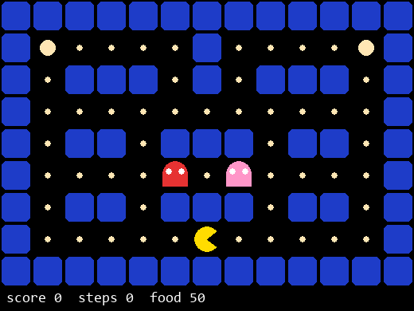
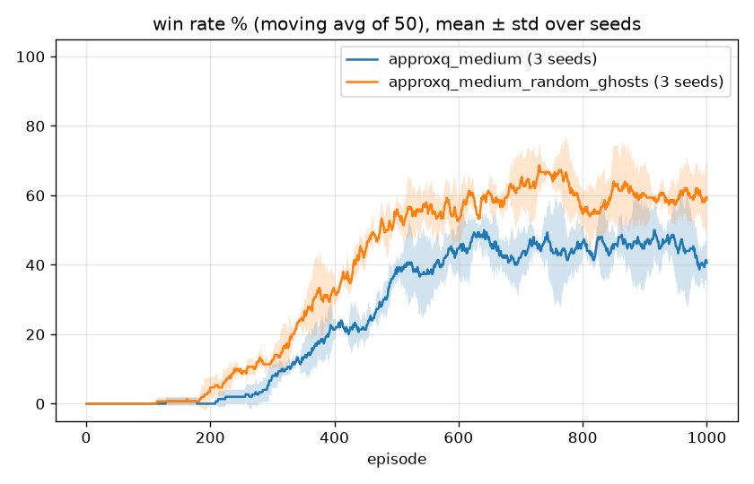
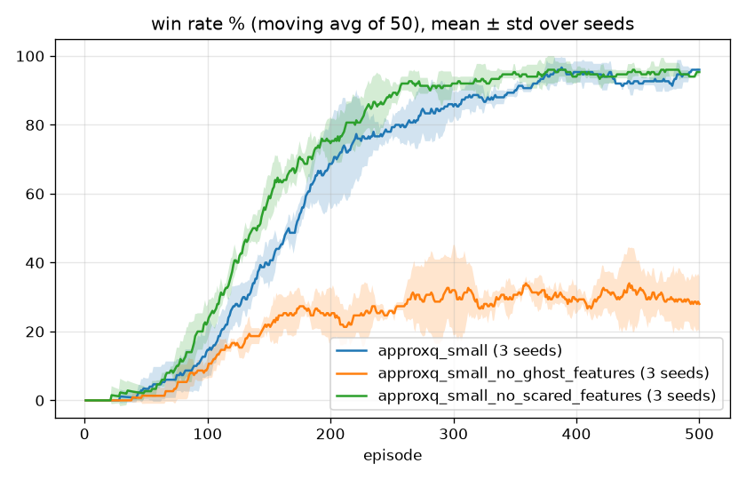

# Mini Pac-Man with Reinforcement Learning

A small Pac-Man game written from scratch, where an agent learns to win only from
rewards, by playing. Two reinforcement learning methods are implemented and compared:

1. **Approximate Q-learning**: a linear model over 8 features I designed by hand
2. **DQN (Deep Q-Network)**: a convolutional network that learns straight from the grid

| DQN, medium maze | approximate Q-learning, small maze |
|---|---|
|  |  |

**Main results** (3 training seeds each, tested on 100 games without random moves):

| agent | small maze (1 ghost) | medium maze (2 ghosts) |
|---|---|---|
| approximate Q-learning | 96% wins, learns in ~230 games | 63% wins |
| DQN | **100% wins**, learns in ~2100 games | **82% wins** |
| lookahead planner (not RL, for comparison) | 99% | 95% |

Approximate Q-learning learns about 10 times faster, DQN ends up better, and the gap
grows on the bigger maze where the hand made features are not enough.

## Contents

1. [Installation](#installation)
2. [Quick start](#quick-start)
3. [The game](#the-game)
4. [Algorithm 1: approximate Q-learning](#algorithm-1-approximate-q-learning)
5. [Algorithm 2: DQN](#algorithm-2-dqn)
6. [Baselines and the planner](#baselines-and-the-planner)
7. [How the experiments were run](#how-the-experiments-were-run)
8. [Results](#results)
9. [Limitations and future work](#limitations-and-future-work)
10. [Project structure](#project-structure)
11. [Tests](#tests)
12. [References](#references)

## Installation

Tested with Python 3.12 on Windows 11.

```
git clone https://github.com/AhmadKais/mini-pacman-rl.git
cd mini-pacman-rl
pip install -r requirements.txt
```

The project uses numpy, PyTorch, pygame, matplotlib and pillow (versions are pinned in
`requirements.txt`). No GPU is needed: all the results here were trained on a CPU. For
a smaller download, install the CPU-only PyTorch first:

```
pip install torch==2.15.0 --index-url https://download.pytorch.org/whl/cpu
```

## Quick start

Trained models are already in `models/`, so you can watch the agents right away:

```
python play.py --agent dqn                       # DQN on the small maze
python play.py --agent dqn --layout medium       # DQN on the medium maze
python play.py --agent approxq                   # approximate Q-learning
python play.py --agent approxq --text            # in the terminal instead of a window
```

Watch an agent learn from zero (about 2 minutes):

```
python train.py --agent approxq --live
python train.py --agent approxq --layout medium --live --fps 5
```

The window shows the game on the left and the learning curves on the right. Every few
episodes the agent plays one game without random moves, so you can see it improve.

| key | effect |
|---|---|
| up arrow | faster |
| down arrow | slower |
| space | pause / continue (training pauses too) |

Closing the window only stops the drawing, training goes on. Ctrl+C stops it.

Other commands:

```
python train.py --agent dqn --episodes 3000      # train DQN on the small maze
python ghost_test.py --games 200                 # do the agents really avoid ghosts?
python planner_test.py --layout medium --depth 3 # how well the planner plays
python generalization_test.py                    # learned weights on other mazes
python make_gif.py --agent dqn --layout medium   # record a game as a gif
python -m unittest -v                            # run the tests

python run_experiments.py                        # every experiment, 3 seeds (many hours)
python summarize.py                              # results table and charts
```

The main `train.py` options:

| option | meaning |
|---|---|
| `--agent approxq / dqn` | which algorithm |
| `--layout tiny / small / medium / unseen` | which maze (or a path to your own maze file) |
| `--episodes N` | number of training games |
| `--seed N` | random seed, so a run can be repeated |
| `--ghost-chase P` | how often the ghosts chase (default 0.2, 0 = random ghosts) |
| `--live`, `--fps N`, `--watch-every N` | live view, its speed, how often a game is shown |
| `--no-double` | DQN without double DQN (ablation) |
| `--drop-features ...` | approximate Q-learning without some features (ablation) |
| `--eps-episodes N`, `--eps-end E` | DQN exploration schedule |
| `--ghost-directions` | DQN also sees which way the ghosts are moving |
| `--eval-every N` | test every N episodes and keep the best model |

## The game

The game is written from scratch in `pacman/`, with a gym-like interface
(`reset()` and `step(action)`), so any agent can be plugged in.

- Pac-Man moves up, down, left or right. Moving into a wall is not allowed.
- He wins by eating all the food (`.`).
- A ghost touching him means game over.
- Eating a capsule (`o`) scares the ghosts for 20 steps. A scared ghost can be eaten,
  it then goes back to its start.
- A game ends after 300 steps at most (this counts as a loss, but never happened with
  the trained agents).

**Ghosts.** A ghost never turns back unless it is in a dead end. At each step it
chases Pac-Man with probability 0.2 (takes the move that gets closest to him, or the
one that gets furthest away when scared), otherwise it picks a random move. The ghosts
have their own seeded random generator, so games can be repeated exactly.

**Mazes** (`pacman/layouts.py`):

| maze | size | ghosts | food | used for |
|---|---|---|---|---|
| tiny | 7×5 | 1 | 9 | tests |
| small | 9×7 | 1 | 23 | main experiments |
| medium | 13×9 | 2 | 50 | main experiments |
| unseen | 11×9 | 2 | 39 | only to test generalization, never trained on |

**Rewards:**

| event | reward |
|---|---|
| each step | -1 |
| food | +10 |
| capsule | +20 |
| eat a scared ghost | +200 |
| win (all food eaten) | +500 |
| caught by a ghost | -500 |

The -1 per step pushes the agent to finish quickly. When a game is cut off by the
step limit, the agents don't treat it as a real end (the state still has a future
value), only being caught or winning is a terminal state.

## Algorithm 1: approximate Q-learning

Normal Q-learning keeps a table with one value per (state, action). Here the number of
states is huge (every position of Pac-Man, the ghosts and every subset of food), so a
table is impossible. Approximate Q-learning describes a state and action with a few
features and learns one weight per feature:

```
Q(s, a) = w1·f1(s, a) + w2·f2(s, a) + ... + wn·fn(s, a)
```

After every step the weights move towards the Q-learning target:

```
diff = (r + γ · max_a' Q(s', a')) − Q(s, a)
wi  ← wi + α · diff · fi(s, a)
```

**Features** (`agents/features.py`), all computed for the cell Pac-Man moves into:

| feature | meaning |
|---|---|
| `bias` | always 1, a constant term |
| `ghosts-1-step-away` | how many active ghosts can reach that cell in one move |
| `ghost-closeness` | 1 / (distance to the closest active ghost + 1) |
| `eats-food` | 1 if the move eats food and no ghost is next to it |
| `closest-food` | maze distance to the closest food, divided by the maze size |
| `eats-capsule` | 1 if the move eats a capsule and no ghost is next to it |
| `eats-scared-ghost` | 1 if the move eats a scared ghost |
| `scared-ghost-closeness` | 1 / (distance to the closest scared ghost + 1) |

Distances are real maze distances (computed once with BFS), not straight lines. All
features are divided by 10 to keep the updates small and stable.

**Settings:** α = 0.1, γ = 0.9, ε-greedy exploration starting at 1.0 and multiplied
each game so it reaches 0.05 after 60% of the training.

The learned weights are easy to read. On the small maze, for example, a ghost one step
away gets about -700, eating food about +640 and getting closer to a scared ghost about
+500, which is exactly the behavior we want.

## Algorithm 2: DQN

DQN replaces the hand made features with a neural network that looks at the whole
board.

**Input.** The board is turned into 6 grids of the maze size (one "image" with 6
channels): walls, food, capsules, Pac-Man, active ghosts and scared ghosts (the scared
grid holds how much scared time is left). With `--ghost-directions` a 7th grid marks the
cell each ghost just came from, so the network can tell which way they are moving.

**Network** (`agents/dqn.py`):

```
input (6 × height × width)
→ conv 3×3, 32 filters, ReLU
→ conv 3×3, 64 filters, ReLU
→ fully connected, 256, ReLU
→ fully connected, 4 (one Q-value per move)
```

**What keeps training stable:**

| technique | why |
|---|---|
| replay buffer (100,000 steps) | trains on random past steps, not only the last few, which are very similar to each other |
| target network (copied every 1000 steps) | the target doesn't move with every update |
| double DQN | the online network picks the next move, the target network scores it, which reduces over-estimation |
| legal move masking | moves into walls are never picked and never used in the target |
| reward × 0.01, Huber loss, gradient clipping at 10 | keeps the updates from blowing up (rewards go up to ±500) |
| ε going down per episode, not per step | early games are very short, so a per-step schedule explores for too long |

**Settings:** Adam with learning rate 2.5e-4, γ = 0.99, batch 64, training starts after
2000 steps and runs every 2 steps, ε from 1.0 to 0.05.

## Baselines and the planner

To see if the learned agents are actually good, they are compared against:

- **random**: any legal move.
- **food-only**: always walks to the closest food and ignores the ghosts.
- **lookahead planner** (`agents/planner.py`): **not a reinforcement learning method.**
  It knows the game rules and how the ghosts move, and searches a few moves ahead
  (expectimax: it takes the best of its own moves and the average over where the ghosts
  can go). It shows how well the game can be played, so we know how much room is left
  above the learned agents.

## How the experiments were run

- Every experiment was trained **3 times with different seeds** (0, 1, 2). Results are
  given as mean ± standard deviation over the 3 runs.
- "Test" means **100 games without random moves** after training. A 100-game test is
  accurate to about ±4%, so smaller differences are not meaningful.
- "Episodes to 80% wins" is the first episode where the win rate over the last 50
  training games reaches 80%.
- Learning curves are moving averages over 50 games, the band is ± 1 standard deviation
  over the seeds.

## Results

| experiment | test win rate | test avg score | episodes to 80% wins |
|---|---|---|---|
| approxq, small maze | 96% ± 1 | 883 ± 13 | 228 ± 27 |
| dqn, small maze | **100% ± 1** | **1073 ± 12** | 2138 ± 161 |
| approxq, medium maze | 63% ± 3 | 794 ± 56 | never |
| dqn, medium maze, 5000 episodes | 73% ± 5 | 1043 ± 36 | never (training reached ~40%) |
| dqn, medium maze, 10000 episodes | 79% ± 4 | 1170 ± 86 | never (training reached ~50%) |
| dqn, medium maze, improved, 6000 episodes | **82% ± 6** | **1237 ± 68** | never (training reached ~55%) |
| dqn, medium maze, improved + best model + epsilon 0.01 | 78% ± 4 | 1173 ± 80 | 3152 ± 188 |


### Small maze

- Both methods solve the small maze with every seed, so the result is not luck.
- Approximate Q-learning learns about **10 times faster** (around 230 episodes, under
  a minute) but DQN ends up a bit better, mostly because it eats more scared ghosts.

### Medium maze, and how DQN was improved

- On the medium maze (2 ghosts, about twice the food) approximate Q-learning only
  wins 63%. Its features only look at the closest ghost and the closest food, one step
  ahead, which is not enough to plan around two ghosts in a bigger maze.
- DQN does better but needs a lot more time. With 5000 episodes it wins 73%, and it
  wins almost nothing until the random moves drop low (around episode 2,700). Each run
  took about 8 hours.
- Its curve was still going up at episode 5000, so I trained it again with 10000
  episodes (about 11.5 hours per run). That got it to **79% wins** and a higher score.
  The training curve flattens out around 45-50% after episode 8,500, so doubling the
  episodes again would probably give only a small gain.
- Almost every game the 10000 episode agent lost was a ghost catching it late in the
  game (about 12 of the 50 food left), not running out of time. So the **improved**
  run changes two things: the random moves fade out over the first 2000 episodes
  instead of 60% of the training (`--eps-episodes 2000`), and the network gets a 7th
  grid with the cell each ghost just came from (`--ghost-directions`). Ghosts never
  turn back, so this shows which way they are going.
- The improved agent starts winning around episode 2,000 instead of 6,000 and gets
  **82% wins with 6000 episodes**, slightly better than 79% with 10000. The gain is
  within the spread between seeds (75%, 84% and 87%), so the clear win is that it gets
  there with 40% fewer episodes. Both changes were made together, so this doesn't say
  which one helped more.
- The test win rate is higher than the training curve because the test has no random
  moves.
- The last run tried two more things on top of the improved one: epsilon goes down to
  0.01 instead of 0.05 (`--eps-end 0.01`), and every 250 episodes the agent plays 50
  test games and only the best version is kept (`--eval-every 250`). **It didn't help**
  (78% vs 82%, inside the spread between seeds):
  - The training curve went up to 70-85%, but only because there are fewer random
    moves in training. The agent itself plays about as well as before.
  - The best checks were 88-90%, but the final 100 game tests of the same models were
    74-81%. With 50 games, picking the highest check also picks the luckiest one.
  - All the DQN versions from 79% to 82% are basically the same within the ±4% test
    accuracy. Telling them apart would need more seeds and more test games.

### How good can it get? A planner to compare with

Every DQN version stopped at about 80% on the medium maze, and every lost game was a
ghost catching Pac-Man. To see if 80% is close to the best possible, the lookahead
planner played 500 games at each search depth. It is not a fair opponent for the
learned agents, because they have to find out the rules by playing, but it shows how
well the game can be played.

| agent (medium maze) | test win rate | avg score |
|---|---|---|
| approxq | 63% | 794 |
| dqn (best version) | 82% | 1237 |
| planner, 1 move ahead | 75% | 869 |
| planner, 2 moves ahead | 87% | 1179 |
| planner, 3 moves ahead | 89% | 1258 |
| planner, 4 moves ahead | 91% | 1377 |
| planner, 5 moves ahead | 95% | 1502 |
| planner, 6 moves ahead | 95% | 1561 |

- **There is room left above DQN.** Looking 5 moves ahead wins 95%, so 80% is not the
  limit of the game. Looking 6 moves ahead adds almost nothing (95.4% vs 94.8%), so
  about 95% seems close to the best possible: roughly 5% of the games look truly lost.
- DQN plays about as well as a planner that looks **1 to 2 moves ahead**. It reacts
  well to a ghost that is close, but doesn't plan far enough to avoid getting trapped
  between two ghosts later.
- On the small maze the planner wins 99% with 3 moves, about the same as DQN (100%).
  The small maze is basically solved by both.

### Does it work on a maze it never saw?

The features of approximate Q-learning don't depend on the maze, so the learned weights
can be used on any maze. `generalization_test.py` takes the weights trained on the small
and on the medium maze and plays 500 games on every maze, including `unseen`.

| weights trained on | tiny | small | medium | unseen |
|---|---|---|---|---|
| small maze | 100% | 96% | 63% | 74% |
| medium maze | 100% | 97% | 59% | 70% |
| *trained on that maze itself* | | *96%* | *63%* | *71% ± 4 (3 seeds)* |

- **The weights transfer with no loss.** The weights from the small maze (1 ghost) win
  just as much on the medium maze as weights trained on the medium maze itself (63%),
  and on the unseen maze they do as well as training on it directly.
- This makes sense: the features describe the situation around Pac-Man, not the maze,
  so "don't step next to a ghost, go for food" works everywhere. What limits it on the
  bigger mazes is the features (they only look one step ahead), not the training maze.
- DQN can't do this. Its network takes the whole grid as input, so a model only fits
  mazes of the size it was trained on, and it learned that one maze.

### Are our ghosts harder than the usual ones?

Other approximate Q-learning projects (on the Berkeley Pac-Man game) report around 90%
wins on their medium maze, more than our 63%. Their ghosts move completely at random by
default, while ours chase Pac-Man 20% of the time. To check how much this matters, the
same training was run with `--ghost-chase 0` (ghosts still never turn back, like the
Berkeley ones):

| experiment (medium maze, 1000 episodes) | test win rate | test avg score |
|---|---|---|
| approxq, ghosts chase 20% of the time | 63% ± 3 | 794 ± 56 |
| approxq, random ghosts | **74% ± 5** | **1003 ± 65** |



- The chasing ghosts cost about **11% of the wins**. With random ghosts every seed wins
  more (76%, 69%, 78%) and the training curve is higher the whole time.
- It still doesn't reach 90%, so the ghosts are only part of the difference. The rest
  comes from the maze itself (ours is not the same maze) and from the features only
  looking one step ahead. The 90% number is also one student project tested on 40
  games, so it is not an exact target.

### Ablations

What happens when parts of the method are taken away (small maze, 3 seeds each):

| experiment | test win rate | test avg score | episodes to 80% wins |
|---|---|---|---|
| approxq (all features) | 96% ± 1 | 883 ± 13 | 228 ± 27 |
| approxq without ghost features | **43% ± 1** | **215 ± 39** | never |
| approxq without scared-ghost features | 97% ± 3 | 876 ± 16 | 213 ± 27 |
| dqn (double DQN) | 100% ± 1 | 1073 ± 12 | 2138 ± 161 |
| dqn without double DQN | 98% ± 2 | 1083 ± 12 | 2423 ± 380 |




- **The ghost features are what makes approximate Q-learning work.** Without
  `ghosts-1-step-away` and `ghost-closeness` the agent can't see danger, and the win
  rate stays around 30% during training (43% in the test).
- The scared-ghost features (`eats-scared-ghost`, `scared-ghost-closeness`) don't change
  the result. On this small maze the scared ghost is usually close anyway, so hunting
  it on purpose doesn't add much.
- **Double DQN helps a little.** It reaches 80% wins about 300 episodes earlier and its
  training win rate stays around 80% instead of 65-75%, but the final test results are
  almost the same. With only 3 seeds and overlapping error bars, this difference is
  small and not conclusive.

### Do they really avoid the ghosts?

`ghost_test.py` plays 200 games per agent on the small maze and compares them with the
two baselines. A *close call* is an active ghost coming within 2 steps of Pac-Man; it
counts as *escaped* if Pac-Man is still alive 3 steps later. The agents were trained
with ghosts chasing 20% of the time, and tested against more aggressive ghosts as well.

| ghosts chase | agent | win | caught | close calls / game | escaped | ghosts eaten / game |
|---|---|---|---|---|---|---|
| 20% | random | 0% | 100% | 1.5 | 38% | 0.18 |
| 20% | food-only | 61% | 39% | 0.7 | 48% | 0.95 |
| 20% | approxq | 99% | 1% | 0.8 | 99% | 1.15 |
| 20% | dqn | **100%** | **0%** | 4.7 | **100%** | **1.81** |
| 50% | random | 0% | 100% | 1.4 | 34% | 0.14 |
| 50% | food-only | 64% | 36% | 0.6 | 40% | 0.74 |
| 50% | approxq | 98% | 2% | 0.8 | 98% | 1.01 |
| 50% | dqn | **100%** | **0%** | 6.0 | **100%** | **1.88** |
| 80% | random | 0% | 100% | 1.2 | 21% | 0.07 |
| 80% | food-only | 64% | 36% | 0.5 | 20% | 0.59 |
| 80% | approxq | 100% | 0% | 1.1 | 100% | 0.86 |
| 80% | dqn | **100%** | **0%** | 6.9 | **100%** | **1.73** |

(`python ghost_test.py --games 200`, seed 0: every agent gets the same random numbers,
so running it again gives exactly this table.)

- Just running for the food isn't enough: food-only gets caught in about a third of its
  games, and escapes fewer close calls as the ghosts get more aggressive.
- Both trained agents escape almost every close call, even against ghosts that chase
  80% of the time, which they never trained against.
- They play differently. Approximate Q-learning stays away from ghosts (about 1 close
  call per game). DQN lets ghosts get close 5 to 7 times a game and always gets away,
  and it eats more scared ghosts (1.7-1.9 per game against 0.9-1.2), which is where its
  higher score comes from.
- An earlier version of `ghost_test.py` counted the winning step as an eaten ghost (both
  give a reward of 200 or more), which made every "ghosts eaten" number too high by
  about the win rate. The game now counts eaten ghosts itself; the table above is from
  the fixed version.

### What we learned

1. Both methods solve the small maze. The simple method learns much faster, DQN ends
   up a bit better.
2. On a bigger maze the hand made features become the limit. DQN learns its own
   features from the whole board and wins more, but needs thousands of games.
3. The planner shows DQN still has room to improve: it reacts to nearby ghosts but
   doesn't plan far enough to avoid being trapped between two of them.
4. Hand made features generalize to new mazes, DQN's learned features don't.
5. With noisy results, how you measure matters: picking the "best" model by short
   tests mostly picks the luckiest one.

## Limitations and future work

**Limitations**
- Only 3 seeds per experiment and 100-game tests, so differences under about 5% can't
  be told apart.
- The DQN medium maze runs took 6 to 11 hours each on a CPU, which limited how many
  variations could be tried.
- The two DQN improvements (shorter exploration and the ghost direction grid) were
  tested together, so their separate effects are unknown.
- A DQN model only works on the maze it was trained on.
- The game is a simplified Pac-Man: small mazes, simple ghost rules, no levels.

**Future work**
- Better DQN versions: dueling networks, n-step returns, prioritized replay.
- A network that doesn't depend on the maze size (only convolutions and pooling),
  trained on many mazes, so DQN can generalize like approximate Q-learning.
- A feature for "number of escape routes" so approximate Q-learning can avoid being
  trapped between two ghosts.
- More seeds and longer tests to separate the small differences.

## Project structure

```
pacman/                 the game
  layouts.py            maze maps, parser and maze distances (BFS)
  env.py                game rules (reset / step, like a gym env)
  ghosts.py             how the ghosts move
  observation.py        the grids the DQN sees
  render.py             pygame drawing (up/down arrows = speed, space = pause)
  text_view.py          the game as text for the terminal
  live_view.py          one window while training: the game + live learning curves
agents/                 the learning code
  features.py           features for approximate Q-learning
  approx_q.py           approximate Q-learning agent
  dqn.py                DQN agent (CNN, target net, double DQN)
  replay_buffer.py      the replay buffer for DQN
  baselines.py          random and food-only agents to compare against
  planner.py            lookahead planner that knows the rules (no learning)
  training.py           one training episode, and the test without random moves
  loading.py            creating / loading agents
tests/                  unit tests for the game rules, features and agents
train.py                train one agent, save the model and a csv log
play.py                 watch a trained agent play
ghost_test.py           check whether the agents really avoid ghosts
planner_test.py         how well the lookahead planner plays
generalization_test.py  approximate Q-learning weights on other mazes
make_gif.py             record a trained agent as a gif
run_experiments.py      run every experiment with 3 seeds
summarize.py            results table and charts for the experiments
plot_results.py         learning curves for single runs
models/                 trained models (dqn_medium.pt is the best medium maze run, seed 0)
results/                training logs, test results, charts and gifs
```

A longer explanation of the theory, every file and function, and the experiments is in
[EXPLANATION.md](EXPLANATION.md).

## Tests

`tests/` has 27 unit tests:

- **Game rules**, on tiny corridor mazes where the outcome is known: walls, eating food,
  winning, getting caught, capsules, eating a scared ghost, the time limit, reset and
  the ghost direction grid.
- **Approximate Q-learning and baselines**: the features, the Q-learning update,
  saving / loading, the food-only baseline and the planner.
- **DQN**: the network output, the replay buffer, that only legal moves are picked,
  the epsilon schedule, that a training step changes the network, and saving / loading.

```
python -m unittest -v
```

## References

- R. Sutton and A. Barto, *Reinforcement Learning: An Introduction*, 2nd edition, MIT
  Press, 2018. (Q-learning, function approximation)
- V. Mnih et al., "Human-level control through deep reinforcement learning", *Nature*
  518, 2015. (DQN, replay buffer, target network)
- H. van Hasselt, A. Guez and D. Silver, "Deep Reinforcement Learning with Double
  Q-learning", AAAI 2016. (double DQN)
- UC Berkeley CS188, *Pac-Man projects*. (the idea of approximate Q-learning with
  Pac-Man features)
