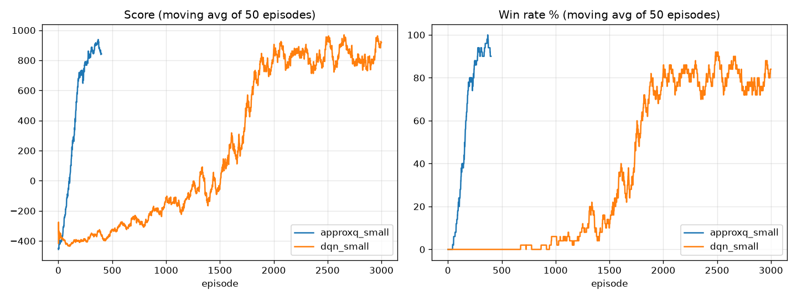

# Mini Pac-Man with Reinforcement Learning

A small Pac-Man game where an agent learns to win on its own, using two methods:

1. **Approximate Q-learning**: a linear model over features I designed by hand
2. **DQN (Deep Q-Network)**: a CNN that learns straight from the grid

## The game

- Pac-Man wins by eating all the food (`.`)
- A ghost touching Pac-Man means game over
- Eating a capsule (`o`) scares the ghosts for 20 steps, and Pac-Man can eat them
- Ghosts mostly move randomly but sometimes chase (`--ghost-chase`, default 0.2)
- Mazes: `tiny`, `small`, `medium` (see `layouts.py`)

| event          | reward |
|----------------|--------|
| each step      | -1     |
| food           | +10    |
| capsule        | +20    |
| eat scared ghost | +200 |
| win            | +500   |
| caught         | -500   |

## Files

| file | what it does |
|------|--------------|
| `layouts.py` | maze maps and the parser |
| `pacman_env.py` | game logic (reset / step, like a gym env) |
| `features.py` | features for approximate Q-learning |
| `approx_q_agent.py` | approximate Q-learning agent |
| `dqn_agent.py` | DQN agent (replay buffer, target net, double DQN) |
| `train.py` | training loop, saves the model and a csv log |
| `play.py` | watch a trained agent play (pygame or terminal) |
| `render.py` | drawing code |
| `live.py` | live chart + game window while training (`--live`) |
| `plot_results.py` | learning curves |
| `ghost_test.py` | checks whether the agents really avoid ghosts |

## How to run

```
pip install -r requirements.txt

python train.py --agent approxq --episodes 500
python train.py --agent dqn --episodes 3000

python play.py --agent approxq
python play.py --agent dqn --text

python plot_results.py results/approxq_small.csv results/dqn_small.csv
python ghost_test.py --games 200
```

Add `--live` to `train.py` to watch the learning curve and a game every few episodes.

Try a bigger maze with `--layout medium` (it needs more episodes for DQN).

## How the algorithms work

**Approximate Q-learning.** Instead of a table with one entry per state,
Q(s,a) = Σ wᵢ·fᵢ(s,a). The features are things like "how many ghosts are one step
away", "distance to the closest food" and "does this move eat food". After every step:

```
diff = (r + γ · max_a' Q(s',a')) − Q(s,a)
wᵢ  ← wᵢ + α · diff · fᵢ(s,a)
```

It learns very fast (a few hundred games), and you can read the weights to see what
it learned, for example a big negative weight on `ghosts-1-step-away`.

**DQN.** The board is turned into 6 grids (walls, food, capsules, pacman, ghosts,
scared ghosts) and passed through a CNN that outputs one Q-value per action.
Some tricks keep training stable:
- a replay buffer, so it trains on random past transitions
- a target network that is updated every 1000 steps
- double DQN to reduce over-estimation
- rewards scaled by 0.01, Huber loss, gradient clipping
- epsilon-greedy exploration going from 1.0 down to 0.05

DQN needs far more games than approximate Q-learning, but it doesn't need any
hand made features.

## Results (small maze)



| | Approximate Q-learning | DQN |
|---|---|---|
| episodes to learn | ~300 (about 1 min) | ~2000 (about 30 min) |
| test win rate (100 games) | 98% | 100% |
| average score | 919 | 1061 |

### Do they really avoid the ghosts?

`ghost_test.py` plays 200 games per agent and compares them with two baselines:
**random** (any legal move) and **food-only** (always walks to the closest food and
ignores the ghosts). A *close call* is an active ghost coming within 2 steps of
pacman; it counts as *escaped* if pacman is still alive 3 steps later.
The agents were trained with ghosts chasing 20% of the time, and tested against
more aggressive ghosts as well.

| ghosts chase | agent | win | caught | close calls / game | escaped | ghosts eaten / game |
|---|---|---|---|---|---|---|
| 20% | random | 0% | 100% | 1.5 | 41% | 0.21 |
| 20% | food-only | 61% | 39% | 0.7 | 44% | 1.50 |
| 20% | approxq | 98% | 2% | 0.8 | 99% | 2.15 |
| 20% | dqn | **100%** | **0%** | 4.8 | **100%** | **2.84** |
| 50% | random | 0% | 100% | 1.4 | 35% | 0.14 |
| 50% | food-only | 64% | 36% | 0.5 | 35% | 1.35 |
| 50% | approxq | 97% | 3% | 1.0 | 97% | 2.00 |
| 50% | dqn | **100%** | **0%** | 6.3 | **100%** | **2.77** |
| 80% | random | 0% | 100% | 1.2 | 19% | 0.06 |
| 80% | food-only | 76% | 24% | 0.3 | 18% | 1.20 |
| 80% | approxq | 100% | 0% | 1.0 | 99% | 1.79 |
| 80% | dqn | **100%** | **0%** | 7.0 | **100%** | **2.71** |

What this shows:
- Just running for the food isn't enough: food-only gets caught in a quarter to a
  third of its games, and escapes fewer close calls as the ghosts get more aggressive.
- Both trained agents escape almost every close call, even against ghosts that chase
  80% of the time, which they never trained against.
- They play differently. Approximate Q-learning stays away from ghosts (about 1 close
  call per game). DQN lets ghosts get close 5 to 7 times a game and always gets away,
  and it eats more scared ghosts, which is where its higher score comes from.
- On the medium maze (2 ghosts) approximate Q-learning wins 56% after 500 episodes,
  so the bigger maze is much harder.
